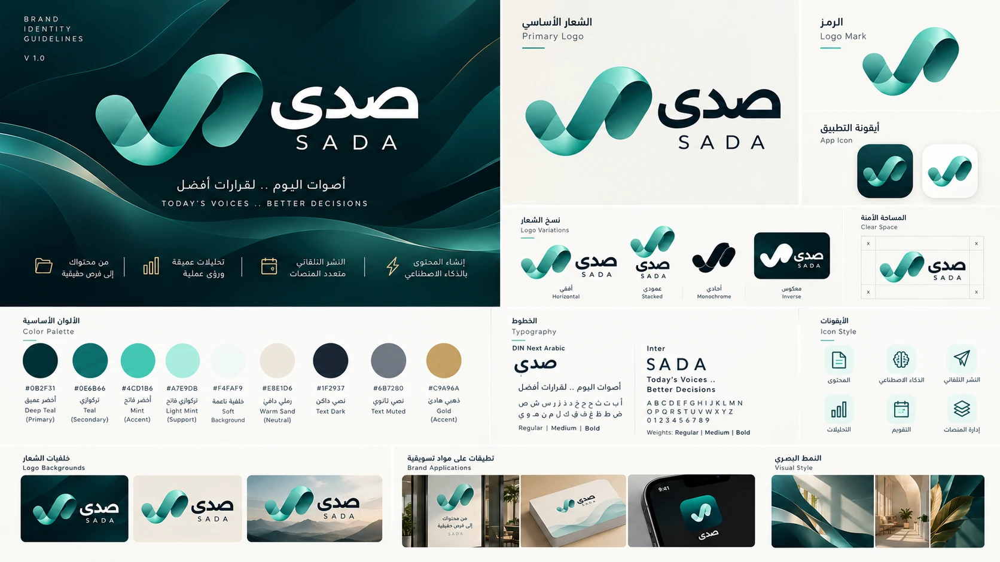

# هويّةُ صدى البصريّة (D-196)

> **المصدر**: لوحةُ الهويّة الرسميّة V 1.0 التي أرسلها المالك، محفوظةً كما وصلت في [`docs/design/brand-board.webp`](design/brand-board.webp)، ثمّ ثلاثةُ مقترحاتٍ حُكِّمت بثلاثة محكّمين (القسم ١). والقيَمُ في `src/routes/ui/tokens.ts`، والقرارُ D-196 في `docs/DECISIONS.md`.
> **كلُّ رقمٍ هنا مقيس**، ومصدرُه `npm run contrast` (‏190 فحصًا تجتاز)، و`npm run audit` (صفرُ ملحوظة)، و`npm run ci` (‏2554 اختبارًا تجتاز بعد دمج D-195). **والرقمُ الحاكم في `scripts/validate_contrast.js` لا هنا**: إن اختلفا فالفحصُ هو الصحيح وهذه الوثيقةُ قديمة.



---

## الخلاصة في دقيقة (للمالك)

- **نهارًا ورقٌ على رمل**: أرضُ الصفحة من «الرمليّ الدافئ» فاتحًا، والبطاقاتُ بيضاء، والمحدَّدُ «الرمليُّ الدافئ» نفسُه. الزرُّ الأوّليُّ «الأخضرُ العميق»، والروابطُ «التركوازيّ» مسطَّرة، والحبرُ مشتقٌّ من الأخضر العميق.
- **ليلًا أرضُ غلاف اللوحة**: أخضرُ فيروزيٌّ يكاد يسودّ، والقسمُ الحاليُّ في الرافدة «الأخضرُ العميق» بقيمته، والزرُّ الأوّليُّ رملٌ بحبرٍ عميق، والروابطُ نعناعٌ مكتوم.
- **النعناعُ ضوءٌ على عمقٍ لا غير.** نعناعُ اللوحة `#4CD1B6` هو القياسُ نفسُه الذي وصفتَه «قاسٍ وليس بقوّة» (D-053). واللوحةُ لا تضعه مصمتًا على فاتح: على الرمليّ والأبيض يقع داخل تدرّجٍ يحمل التركوازَ والعمق، ولا تدرّجَ في الواجهة. فلا يكون زرًّا ولا محدَّدًا ولا نصًّا على فاتح. يبقى بقيمته في شريط العلامة على مربّعها العميق، وفي لحظات العلامة. ويحرسه فحصٌ آليّ.
- **الذهبُ خلَف النحاس بالقاعدة نفسِها**: ثلاثةُ مواضعَ في الشاشة لا رابعَ لها. ليلًا هو ذهبُ اللوحة `#C9A96A` بقيمته، ونهارًا يُعتَم إلى برونز `#7B5E20` لأنّ ذهبَ اللوحة على الأبيض ‏2.24:1 لا يُقرأ.
- **ألوانُ الحال ليست الهويّة**: «جيّد» صار أخضرَ غابٍ عميقًا يتمايز عن التركواز، وعن الذهب والتحذير والأحمر عند من لا يميّز الألوان.
- **نقشُ الصدى** شريطُ الشعار مكبَّرًا ثمّ صداه خطوطًا تخفت. يظهر في الدخول والعامل الثاني الآن، وفي أوّل تشغيلٍ والحالاتِ الفارغة والصورِ المنشورة لاحقًا. **ولا يظهر في سطح عملٍ أبدًا.**
- **ما عليك**: مهمّتان في القسم ١١. طلبُ ملفّ الشعار المتّجه من مصمّم اللوحة (M-26)، واعتمادُ هويّة الصور المنشورة (M-25). **وهويّةُ اللوحة طُبّقت على لوحة التحكّم كما طلبت**، وتراها على `sada2.basserh.com` بعد الدمج. أمّا ما يراه متابعوك فلا يتبدّل منه شيءٌ قبل اعتمادك.

---

## ١ · القرار وما بُني عليه

قُدّمت ثلاثةُ مقترحاتٍ على المفاتيح الثابتة في `tokens.ts`، وحكّمها ثلاثةُ محكّمين بأربعة مقاييس (الوفاءُ للّوحة، والوصول، والفخامة، والاستعمال):

| المقترح | المحكّم ١ | المحكّم ٢ | المحكّم ٣ | المجموع |
|---|---|---|---|---|
| أ · الوفاءُ للّوحة | 31 | 30.5 | 25 | 86.5 |
| **ب · الفخامةُ الدافئة** | 29 | 32 | 32 | **93** |
| ج · الانضباطُ التحريريّ | 26 | 24 | 26 | 76 |

**فالأساسُ «ب»**: رملٌ وحبرٌ فيروزيٌّ وذهبٌ واحد. وطُبّق عليه **كلُّ ما أوجبه محكّمٌ**، وكلُّ ترقيعٍ أيّده محكّمان فأكثر:

| ما تغيّر عن «ب» | لماذا | من طلبه |
|---|---|---|
| المحطّةُ المنتظِرة في «رحلة المنشور» على البطاقة البيضاء لا على السطح الداخليّ | حدٌّ برتقاليٌّ على سطحٍ رمليّ قُرئ أرضَ تحذير، فخمسُ محطّاتٍ من سبعٍ بدت «حالًا» بلا حال | الثلاثة (وبعد دمج D-194 صارت المحطّاتُ قمعًا حبرُه واحد، والمميَّزةُ وحدَها بلون حالها — المقصدُ نفسُه) |
| السطحُ الداخليُّ النهاريّ `#f2ece4` ← `#f1efeb` | كان بإشباع أرضَي التحذير والخطر (‏0.013)، فصار محايدًا (‏0.006) بلون ألواح اللوحة المرسومة | المحكّم ٣ |
| «جيّد» النهاريّ `#2c7219` ← `#14610d` | عند عمى الأخضر كان «جيّد» و«خطر» ‏2.9 (لا يُفرَّقان)، وصار ‏8.6. ونقاطُ الرافدة لونٌ بلا كلمة | المحكّم ٢ |
| «جيّد» `#14610d` ← `#0e4304` نهارًا و`#72bf55` ← `#62bc6b` ليلًا (مراجعة D-196) | نقاطُ الرافدة ثلاثٌ لا اثنتان: «جيّد» و«تحذير» كانا ‏3.8 عند عمى الأحمر نهارًا و‏3.1 عند عمى الأخضر ليلًا ولا يُفحصان. وأرضُ النهار المجمَّدة تمنع التحذيرَ أن يفتح، فأُعتم «جيّد» | المراجعة |
| رمزُ القسم الحاليّ في الرافدة بحبر الرابط، وخطٌّ قصيرٌ ‏24×2 بحبر الرابط تحت عنوان الصفحة | التركوازُ نهارًا لا يُرى إلّا في الأزرار والروابط؛ واللوحةُ تضع هذا الخطَّ تحت كلّ عنوان | المحكّم ١ |
| ذهبُ النقش من الرموز، وصداه شريطُ العلامة | كان `#d2b57c` ذهبًا ثالثًا يفلت من عدّ الذهب | الثلاثة |
| النصُّ على العمق عاجيٌّ و«نعناعٌ فاتح» لا نعناع | النعناعُ حرفًا صغيرًا ‏Lc 62.9، دون ما يُطلب من رابط | الثلاثة |
| الأيقونةُ (favicon) مربّعٌ عميقٌ وشريطٌ نعناعيّ | كانت تدرّجًا نحاسيًّا على حبر، فالتبويبُ والرافدةُ هويّتان | المحكّمان ١ و٣ |
| فحوصٌ جديدة: حبرُ العلامة نصًّا، وإشباعُ النعناع، وبُعدُ الشريط عن الرابط والحال والذهب، وعمى الألوان | مقترحٌ كاملٌ مرّ من الفحوص الـ132 وحبرُ علامته على البطاقة ‏2.83:1 | الثلاثة |
| تجميدُ أرض النهار `#f9f4ec` وتحذير الليل `#f2823b` | هما أرقُّ الأزواج (‏4.59:1 و‏Lc 50.4) | المحكّمان ٢ و٣ |
| التمريرُ على شريط العودة لونٌ وخطّ | الثانويُّ وحبرُ العلامة ليلًا متقاربان ضوءًا | المحكّم ٢ |
| القفلُ كما في اللوحة: الرمزُ يسارَ الاسم | الرافدةُ كانت تضعه يمينه، أي قفلًا مقلوبًا | المحكّم ٣ ورأيُ المحكّم ١ في النقش |
| الشريطُ حريرٌ بثلاث درجات، وأربعةُ أصداءٍ افتراضًا وستّةٌ سقفًا، وصدًى واحدٌ في الحالة الفارغة | الشريطُ المصمتُ قُرئ رسمًا بيانيًّا أو منحدرًا | الثلاثة |

**وأُخذ بقيمتين من «أ» لميزتهما وإن طلبهما محكّمٌ واحد:** تمريرُ الليل `#082225` ← `#082528` (فرقُه عن البطاقة ‏1.08 ← ‏1.12:1، فيُرى في الجداول الطويلة)، وحلقةُ العلامة ليلًا `#3a5253` ← `#4a6362` (‏2.33 ← ‏3.01:1 على الأرض، وهي وحدها ترسم حافّةَ مربّعٍ عميقٍ على أرضٍ أعمق).

**ولم يُؤخذ:** «النعناعُ الفاتح» أرضًا للنصّ المحدَّد نهارًا (اقترحه محكّمٌ وعارضه آخر: تعبئةٌ نعناعيّةٌ على أبيض)، وخافتُ الليل `#97a7a6` (اقتُرح لـ«أ»، وخافتُ «ب» يجتاز ‏Lc 48.3)، ورمزٌ مستقلٌّ لرسوم البيانات (لا رسمَ يحتاجه اليوم، فصار قاعدةً في القسم ٤).

---

## ٢ · اللوحة وأدوارها

### الألوانُ التسعة وأين تقع

| اللون | الاسم في اللوحة | على الأبيض | على العمق | دورُه في صدى |
|---|---|---|---|---|
| `#0B2F31` | أخضر عميق | 14.33:1 | 1.00:1 | **بقيمته**: الزرُّ الأوّليُّ نهارًا، وأرضُ العلامة، والمحدَّدُ ليلًا، وحبرُ الزرّ ليلًا، وأرضُ لحظة العلامة |
| `#0E6B66` | تركوازي | 6.34:1 | 2.26:1 | **بقيمته**: الرابطُ والتركيزُ نهارًا، وجسمُ شريط النقش |
| `#4CD1B6` | أخضر فاتح | 1.89:1 ✗ | 7.58:1 | **بقيمته في موضعين لا ثالث لهما**: شريطُ العلامة على مربّعها، وأصداءُ النقش على العمق |
| `#A7E9DB` | تركوازي فاتح | 1.37:1 ✗ | 10.46:1 | نصٌّ على العمق: السطرُ اللاتينيّ والفوقيّة، ولمعةُ الحرير. لا يقع على فاتح |
| `#F4FAF9` | خلفيّة ناعمة | 1.06:1 ✗ | 13.57:1 | حبرُ الاسم والشعار العربيّ على العمق. لا يصير أرضًا للّوحة (قارن القسم ٤) |
| `#E8E1D6` | رملي دافئ | 1.30:1 | 11.04:1 | **بقيمته**: المحدَّدُ والمضغوطُ نهارًا، والزرُّ الأوّليُّ ليلًا. ومنه أرضُ النهار وخيوطُه |
| `#1F2937` | نصّي داكن | 14.68:1 | 1.02:1 | **لا يُستعمل**: رماديُّ Tailwind بهيولى زرقاء (‏257°) ينازع الرمل؛ والحبرُ من الأخضر العميق |
| `#6B7280` | نصّي ثانوي | 4.83:1 | 2.96:1 | **لا يُستعمل**: لا يبلغ ‏7:1 المطلوبة للثانويّ تحت ‏15px |
| `#C9A96A` | ذهبي هادئ | 2.24:1 ✗ | 6.39:1 | **بقيمته ليلًا** (الذهبُ وخيطُ النقش). ونهارًا يُعتَم على هيولاه (‏83°) إلى `#7B5E20` |

وتُسمّى الألوانُ المنقولةُ حرفًا مرّةً واحدة في `BOARD` داخل `tokens.ts`، **ومن يبدّل قيمةً هناك يبدّل الهويّة**.

### النِّسَب: ‏60 و30 و10

**في التكوينات** (لحظاتُ العلامة، والصورُ المنشورة، والمطبوعات):

| النسبة | ما هي |
|---|---|
| ‏60 | أرضٌ «أخضرُ عميق» |
| ‏30 | حريرٌ تركوازيٌّ ونصٌّ عاجيّ |
| ‏10 | نعناعٌ ونعناعٌ فاتح ضوءًا، وخيوطُ ذهبٍ رفيعة: خيطُ النقش على حافّة شريطه، وفي الصورة المنشورة خيطٌ تحت الفوقيّة |

**وفي اللوحة اليوميّة** (أدواتُ العمل): الأرضُ والأسطحُ هي الغالبة عمدًا (انضباط D-144)، والهويّةُ في مواضعَ قليلةٍ ثابتة. قيست اللقطاتُ النهائيّة بالبكسل: في الرئيسيّة ‏1440 الأسطحُ ‏86.8٪، وألوانُ الحال ‏9.8٪، والحبرُ ‏1.5٪، والهويّةُ ‏0.8٪ نهارًا و‏1.9٪ ليلًا، و‏4.7٪ في ‏390. **والذهبُ والنعناعُ نقاطٌ لا نِسَب**: ثلاثةُ مواضعَ على الأكثر.

---

## ٣ · خريطةُ الرموز

المفاتيحُ ثابتة (`DARK` مكتوبٌ على مفاتيح `LIGHT`)، والقيَمُ من `src/routes/ui/tokens.ts`. والنسبُ من `npm run contrast`: WCAG، وAPCA Lc حيث يحكم.

### الأسطحُ والحبر

| الرمز | نهارًا | ليلًا | الدور |
|---|---|---|---|
| `--bg` | `#f9f4ec` **مجمَّد** | `#020f11` | أرضُ الصفحة والرافدة والشريط العلويّ |
| `--surface` | `#ffffff` | `#041a1c` | البطاقةُ والحوار |
| `--surface-2` | `#f1efeb` | `#082528` | السطحُ الداخليّ والتمرير |
| `--surface-3` | `#e8e1d6` رمليّ | `#0b2f31` عميق | المحدَّدُ والمضغوطُ والعدد |
| `--line` · `--line-soft` | `#d9d2c6` · `#e7e3db` | `#1e383a` · `#11282a` | حدُّ زينةٍ يسنده الظلّ |
| `--field` | `#718383` | `#657b7b` | حدُّ ما يُكتب فيه ويُضغط |
| `--ink` | `#0a2021` | `#f0ece3` | المتن |
| `--ink-2` | `#364748` | `#cad3d3` | الثانويّ، وكلُّ نصٍّ تحت ‏15px |
| `--ink-3` | `#5a6969` | `#92a0a0` | الخافت، ‏15px فأكبر ولنصٍّ لا يُحتاج |

| الزوج | نهارًا | ليلًا | الحدّ |
|---|---|---|---|
| المتن على البطاقة | 16.92:1 · Lc 103.8 | 15.23:1 · Lc 94.5 | ‏4.5 · Lc 90 |
| الثانويّ على البطاقة / الأرض / الداخليّ / المحدَّد | 9.76 / 8.91 / 8.50 / 7.52 · Lc 92.6 | 11.77 / 12.76 / 10.55 / 9.40 · Lc 77.7 | ‏7 (‏4.5 على المحدَّد) · Lc 75 |
| الخافت على البطاقة / الأرض / الداخليّ | 5.74 / 5.24 / 5.00 · Lc 78.7 | 6.63 / 7.19 / 5.94 · Lc 48.3 | ‏4.5 · Lc 45 |
| حدُّ الحقل على البطاقة / الداخليّ / الأرض | 3.98 / 3.47 / 3.63 | 3.99 / 3.58 / 4.33 | ‏3 |
| البطاقةُ على الأرض (زينة) | 1.09:1 · ΔE_OK 3.3 | 1.08:1 | يُطبَع |
| التمريرُ على البطاقة | 1.15:1 · ΔE_OK 4.8 (وعلى الأرض 1.05:1) | 1.12:1 · ΔE_OK 4.4 | يُطبَع |

### الهويّة

| الرمز | نهارًا | ليلًا | الدور |
|---|---|---|---|
| `--brand` | `#0b2f31` | `#e8e1d6` | تعبئةُ الزرّ الأوّليّ، ومِلءُ المقياس، والوسمُ في إطار المنصّة الفاتح |
| `--brand-hover` · `--brand-press` | `#113b3d` · `#154445` | `#dfd8cc` · `#d8d0c3` | أحوالُ الزرّ |
| `--on-brand` | `#faf6f0` | `#0b2f31` | نصُّ الزرّ |
| `--link` · `--focus` | `#0e6b66` | `#8ee0d0` | الرابطُ والزرُّ الهادئ (مسطَّرين دائمًا) وحلقةُ التركيز، ورمزُ القسم الحاليّ وخطُّ العنوان |
| `--selection` | `#cceae7` | `#103f3b` | أرضُ النصّ المحدَّد |
| `--au` | `#7b5e20` | `#c9a96a` | الذهب: ثلاثةُ مواضع |
| `--mark-bg` · `--mark-fg` | `#0b2f31` · `#4cd1b6` | كالنهار | العلامة، ثابتةٌ في الثيمين (`MARK`) |
| `--mark-ring` · `--logo-ring` | خيطُ البطاقة · شفّاف | `#4a6362` | حافّةُ العلامة ومربّعِ المنصّة ليلًا |

| الزوج | نهارًا | ليلًا | الحدّ |
|---|---|---|---|
| نصُّ الزرّ الأوّليّ (عاديّ / تمرير / ضغط) | 13.31 / 11.36 / 10.03 | 11.04 / 10.12 / 9.37 | ‏4.5 |
| حبرُ العلامة نصًّا على البطاقة / الداخليّ / الأرض | 14.33 / 12.48 / 13.09 | 13.83 / 12.39 / 14.99 | ‏4.5 (جديد) |
| مِلءُ المقياس على مجراه | 11.04 | 11.04 | ‏3 (جديد) |
| الرابطُ على البطاقة / الأرض | 6.34 / 5.79 · Lc 81.1 | 11.73 / 12.72 · Lc 77.6 | ‏4.5 · Lc 70 |
| رمزُ القسم الحاليّ على المحدَّد | 4.88 | 9.37 | ‏3 (جديد) |
| الذهبُ نصًّا على البطاقة / الأرض | 6.06 / 5.54 · Lc 80.2 | 8.01 / 8.68 · Lc 56.9 | ‏4.5 · Lc 45 |
| الذهبُ مؤشّرًا على المحدَّد (رمز) | 4.67 | 6.39 | ‏3 |
| النصُّ المحدَّد | 13.28 | 9.92 | ‏4.5 |
| حلقةُ العلامة على الأرض / البطاقة | خيطُ البطاقة (لا حلقة) | 3.01 / 2.78 | ‏2 |
| الذهبُ مقابل التحذير | ΔE_OK 10.4 | ΔE_OK 10.3 | ‏9.5 |
| شريطُ العلامة مقابل الرابط / «جيّد» / الذهب | 30.7 / 45.1 / 32.1 | **7.9** / 9.6 / 15.9 | ‏7.5 (جديد) |
| إشباعُ كلّ رمزٍ في أسرة النعناع (‏165° إلى ‏195°) | الرابط ‏0.079 | الرابط ‏0.084 | ‏0.090 (جديد) |
| وفي `:root` خارج الثيمين (`--moment-soft`، والشريطُ وحده مستثنًى) | 0.069 · ΔE_OK 11.8 | كالنهار | ‏0.090 · ‏7.5 (مراجعة D-196) |

### الحال

| الرمز | نهارًا | ليلًا |
|---|---|---|
| `--ok` · `--ok-wash` | `#0e4304` · `#edf8eb` | `#62bc6b` · `#0f1c0f` |
| `--warn` · `--warn-wash` | `#b45309` · `#fdf4ec` | `#f2823b` **مجمَّد** · `#231206` |
| `--bad` · `--bad-wash` | `#b3261e` · `#fcefee` | `#f49595` · `#271111` |

| الزوج | نهارًا | ليلًا | الحدّ |
|---|---|---|---|
| «جيّد» / «تحذير» / «خطر» على البطاقة | 11.52 / 5.02 / 6.54 | 7.63 / 6.87 / 8.19 | ‏4.5 |
| على الأرض | 10.52 / **4.59** / 5.97 | 8.27 / 7.44 / 8.88 | ‏4.5 |
| الحبّةُ على أرضها | 10.55 / 4.62 / 5.83 · Lc 90.0 / 68.3 / 73.0 | 7.48 / 6.92 / 8.16 · Lc 54.6 / **50.4** / 58.1 | ‏4.5 · Lc 50 |
| «جيّد» مقابل «خطر» عند عمى الأحمر / الأخضر | 5.4 / 18.3 | 8.0 / 5.9 | ‏5 (جديد) |
| «جيّد» مقابل «تحذير» عند عمى الأحمر / الأخضر | 14.1 / 23.7 | 9.8 / 5.9 | ‏5 (مراجعة D-196) |
| «تحذير» مقابل «خطر» عند عمى الأحمر / الأخضر | 9.3 / 5.5 | 11.3 / 9.3 | ‏5 (مراجعة D-196) |
| «جيّد» مقابل الرابط | ΔE_OK 16.3 | ΔE_OK 15.8 | يُطبَع |

### الطباعة

الورقُ أبيضُ في الوضعين (D-125): قيَمُ النهار، والأرضُ `#ffffff`، والسطحان `#f5f3f0` و`#ede8e0`، ومسرحُ المقطع أبيضُ بحبر المتن. **وكلُّ الأزواج أعلاه تجتاز على الورق** (الثانويّ على الداخليّ ‏8.81:1)، ولحظةُ العلامة لا تُطبَع.

### لحظةُ العلامة والعلامة (`MOMENT` و`MARK`)، ثابتتان في الثيمين

| الزوج | النسبة | Lc | الحدّ | الاستعمال |
|---|---|---|---|---|
| `#4cd1b6` على `#0b2f31` | 7.58:1 | 62.9 | ‏7.5 | شريطُ العلامة، والأصداء |
| `#f4faf9` على `#0b2f31` | 13.57:1 | 99.7 | ‏7 · Lc 90 | الاسمُ والشعارُ العربيّ والعنوان |
| `#a7e9db` على `#0b2f31` | 10.46:1 | 81.5 | ‏4.5 · Lc 75 | السطرُ اللاتينيّ والفوقيّة، ولمعةُ الحرير |
| `#c9a96a` على `#0b2f31` | 6.39:1 | 54.0 | ‏3 | خيطُ الذهب (رمز) |
| `#0e6b66` و`#2f958c` على `#0b2f31` | 2.26 و3.96 | يُطبَع | زينة | جسمُ الحرير ووجهُه المضاء |
| `#0b2f31` على أرض الليل / النهار | 1.36 / 13.09 | يُطبَع | سطحٌ لا حدّ | حدُّ لوحة اللحظة يُقرأ بالهيولى ليلًا |

---

## ٤ · القواعد

### النعناع

1. **النعناعُ `#4CD1B6` ضوءٌ على الأخضر العميق لا غير**: شريطُ العلامة على مربّعها، وأصداءُ النقش. لا تعبئةَ ولا نصَّ ولا حدَّ على فاتح، ولا زرَّ ولا محدَّدَ ولا حالَ في أيّ وضع.
2. **لا نصَّ بالنعناع.** النصُّ على العمق عاجيٌّ `#F4FAF9` أو «نعناعٌ فاتح» `#A7E9DB`.
3. **ورابطُ الليل نعناعٌ مكتوم** `#8ee0d0`: إشباعُه ‏0.084 (الحدُّ ‏0.090 من D-053)، وبُعدُه عن شريط العلامة ΔE_OK ‏7.9. يحرس `validate_contrast` الأسرةَ كلَّها (هيولى ‏165° إلى ‏195°): إشباعٌ ‏0.090 فأقلّ، وبُعدٌ ‏7.5 فأكثر، **ولا `--brand` فاتحٌ من الأسرة**. وأُمسك بهذا الفحص رابطُ المقترح «أ» `#74dec6` وزرُّه النعناعيّ.
4. **`--mark-fg` لا يساوي رمزًا آخر، ولا اسمَ ثانيًا له**: يعدّ `audit_design` الذهبَ بقيمة `--au` و`--mark-fg` حرفًا، فرابطٌ بلون الشريط يصير كلُّه «ذهبًا»، وحالٌ بلونه تُقرأ هويّة. يحرسه `views.test` بالمساواة على الورقة كلِّها و`validate_contrast` بالبُعد وبإشباع `:root` كلِّه، و`audit_tokens` يعرف الذهبَ بقيمته لا باسمه. **وأُمسك بذلك** `--moment-accent` (مراجعة D-196): اسمٌ ثانٍ للشريط مرّ من الحرّاس الثلاثة، فحُذف وصار الرمزُ في اللحظة `--mark-fg` نفسَه.

### الذهب

5. **ثلاثةُ مواضعَ في الشاشة لا رابعَ لها**: العلامة، ومؤشّرُ القسم الحاليّ، والرقمُ البطل. وشريطُ العلامة النعناعيُّ يُعَدّ أوّلَها. **ولحظةُ العلامة بنقشها وخيطها ورمزها موضعٌ واحد**، فأوّلُ تشغيلٍ (العلامة، والمؤشّر، واللحظة) ثلاثة. **واللحظةُ تمتصّ نقشَها ورمزَها وحدهما**: ذهبٌ آخرُ فيها يُعَدّ موضعًا. ويُستثنى القالب T6 (الدخولُ والعاملُ الثاني).
6. **ذهبان لا ثلاثة**: `#7B5E20` نهارًا و`#C9A96A` ليلًا. وخيطُ النقش يقرأ ذهبَ الليل من `THEME`، وخيطُ النغمة الفاتحة ذهبَ النهار. لا قيمةَ ذهبٍ مكتوبةً في غير `tokens.ts`.
7. الذهبُ حبرٌ أو أرضٌ بقيمته الكاملة. **لا** حدَّ بطاقة، ولا خطَّ تحت رابط، ولا شريطَ رسم، ولا حال، ولا وهج، ولا سطحَ مملوءًا. ولا نصَّ ذهبيًّا على المحدَّد الرمليّ: ‏4.67:1 يجتاز حدَّ WCAG بـ‏0.17 وحدها، و**Lc ‏62.9 دون ‏75** التي يطلبها كلُّ نصٍّ تحت ‏15px (والمحدَّدُ قسمُ الرافدة الحاليّ، ونصُّه ‏15px). فيمرّ مؤشّرًا (‏3:1) لا نصًّا.

### التركواز والعمق

8. **«الأخضرُ العميق» بنيةٌ لا حال**: الزرُّ الأوّليُّ نهارًا، وأرضُ العلامة، والمحدَّدُ ليلًا، وحبرُ الزرّ ليلًا، وأرضُ اللحظة.
9. **«التركوازيّ» لونُ ما يُضغط نهارًا**: الرابطُ والزرُّ الهادئ مسطَّرين، وحلقةُ التركيز، ورمزُ القسم الحاليّ، وخطُّ عنوان الصفحة القصير. لا يصير تعبئةً ولا حدَّ زينة.
10. **الخطُّ تحت الرابط ليس اختيارًا**، في كلّ حالٍ ومنها التمرير. ليلًا الرابطُ والثانويُّ متقاربان ضوءًا (‏1.00:1، وعند عمى الأخضر ΔE_OK ‏1.3)، فالخطُّ هو العلامة.

### الأرض

11. **نهارًا ورقٌ على رمل**: الأرضُ `#f9f4ec`، والبطاقةُ بيضاء، والداخليُّ محايد، والمحدَّدُ «الرمليُّ الدافئ». **«الخلفيّةُ الناعمة» `#F4FAF9` لا تصير أرضًا للّوحة**: باردةٌ (‏185°) تحت رملٍ دافئ، وألواحُ اللوحة المرسومة نفسُها دافئة.
12. **ليلًا ارتفاعٌ بالدرجة لا بالظلّ**: الأرض، فالبطاقة، فالداخليُّ والتمرير، فالمحدَّد «الأخضرُ العميق».
13. **أرضُ النهار وتحذيرُ الليل مجمَّدان.** التحذيرُ على الأرض ‏4.59:1، وحبّةُ تحذير الليل ‏Lc 50.4، وكلاهما على الحدّ. من يدفئ الأرض أو يعتمها، أو يُميل التحذيرَ نحو الذهب، يُسقط الفحص. ويثبّتهما `views.test`.

### الحال

14. **ألوانُ الحال للحال وحدها**، ومعها رمزٌ وكلمةٌ دائمًا. «جيّد» أخضرُ غابٍ (‏141° نهارًا، ‏146° ليلًا) بعيدٌ عن التركواز (ΔE_OK ‏16.3 و‏15.8).
15. **نصُّ الحال على البطاقة أو الأرض أو أرضه وحدها**، لا على الداخليّ ولا المحدَّد (التحذيرُ على الداخليّ ‏4.37:1).
16. **ما ينتظر على البطاقة البيضاء**: حدٌّ برتقاليٌّ على سطحٍ رمليّ يُقرأ أرضَ تحذير. (صار القمعَ في D-194: حبرٌ واحد، والمميَّزةُ وحدَها بلون حالها.)
17. **ونقاطُ الرافدة لونٌ بلا كلمة**، ونقاطُها ثلاث: «جيّد» و«تحذير» و«خطر»، **فأزواجُها الثلاثة** تتمايز عند عمى الأحمر والأخضر بـ ΔE_OK ‏5 فأكثر في النهاريّ والداكن والطباعة (فحصٌ جديد؛ وكان زوجًا واحدًا حتّى المراجعة). وما بقي مطبوعًا دون ‏5 لا يُردّ، كلُّه: نهارًا الذهبُ مقابل التحذير عند عمى الأحمر ‏1.8؛ وليلًا الرابطُ مقابل الثانويّ ‏1.1 و‏1.8 (والخطُّ تحته هو العلامة، القاعدة ١٠)، و«جيّد» مقابل الذهب ‏2.0 و‏3.9، والذهبُ مقابل التحذير عند عمى الأخضر ‏4.6. والرمزُ والكلمةُ يحملانها.

### الرسوم البيانيّة

18. الرسمُ بالحبر (`--ink` و`--ink-2`) ومِلءُ المقياس بـ`--brand`. **وإن احتاج رسمٌ لونَ هويّةٍ ثانيًا** يُضاف رمزٌ باسمه (`--chart-accent`) بفحصه، ولا يدخل النعناعُ الرسمَ من `--brand`. ولا نقشَ صدًى بجوار رسم: الخطوطُ المتوازيةُ تُقرأ بيانات.

---

## ٥ · نقشُ الصدى ولحظاتُ العلامة

### الفكرة

«صدى» صوتٌ يعود متأخّرًا وأخفت. **فالنقشُ شريطُ الشعار نفسُه**، طرفٌ ثمّ وادٍ ثمّ صعودٌ طويلٌ بزاوية الشعار إلى قمّة، مكبَّرًا ومقصوصًا، ثمّ يتردّد تحته خطوطًا تبتعد وتخفت وتتسطّح. وخيطُ ذهبٍ واحدٌ يحدّه كما تحدّ خيوطُ الذهب الحريرَ في اللوحة. العمودُ الفقريُّ مقيسٌ على «الشعار الأساسيّ» في اللوحة (الوادي ‏0.36 و‏0.86، والقمّة ‏0.76 و‏0.14، النسبة ‏1.41)، والطيّةُ لا تُنسَخ.

### المولّد

`src/routes/ui/echo.ts`:

```ts
echo({ width, height, tone: 'deep' | 'light', density?, crest?, level?, scale?, hairline?, ribbon?, ground?, align? }): string
```

- **حتميّ** بلا بذرة، و**تحت السياسة**: سماتُ عرضٍ فقط، لا `style` ولا `id` ولا `href`، و`aria-hidden`.
- **الحريرُ ثلاثُ درجاتٍ لا تدرّج**: جسمٌ `#0e6b66`، ووجهٌ مضاءٌ `#2f958c` (وسيطُ تدرّج الشعار المقيس) يتّسع عند القمّة ويذوب جرسيًّا نحو الطرفين، وخيطُ لمعةٍ «نعناعيٌّ فاتح» بشفافيّة ‏0.45 على الحافّة. التدرّجُ يطلب معرّفًا يتصادم حين يُضمَّن النقشُ مرّتين.
- **الأصداء**: أربعةٌ افتراضًا في النغمة العميقة وستّةٌ سقفًا، واثنان في الفاتحة. كلُّ صدًى أبعدُ بـ ×1.22 وأقلُّ سعةً بـ ×0.8 وأخفتُ بـ ×0.76 وأرقُّ خطًّا (‏1.5 إلى ‏0.75).
- **النغمتان**: العميقةُ بأرضها وحريرها وخيطِ ذهب الليل، والفاتحةُ بلا أرضٍ وبـ`currentColor` (يُعطى `--ink-3`) وبلا ذهب.
- **الألوانُ كلُّها من `MOMENT`** في `tokens.ts`، **ومشتقّةٌ لا مكتوبة**: الأرضُ أرضُ العلامة، والصدى شريطُها، والخيطُ `THEME.dark['--au']`. ويثبّت ذلك `echo.test.ts`.
- **والمماسُّ متّصلٌ عند كلّ وصلٍ بعد التقريب** (مراجعة D-196): المقبضُ الصادرُ على امتداد الوارد كما كُتب، وبمنزلةٍ عشريّة؛ فأكبرُ انكسارٍ ‏0.17° (كان ‏4.5° في الخيط الذهبيّ يكبّره `slice`). و`data-echo` على الـsvg نفسِه علامةُ النقش للحارس.
- الحجم: لوحةُ الدخول ‏600×900 نحو ‏2.3KB، وشريطُ الجوّال ‏390×240 نحو ‏2.0KB، والشريحةُ ‏1200×628 نحو ‏2.4KB، والحالةُ الفارغةُ ‏160×96 بصدًى وشريط نحو ‏0.9KB.

ويُرى مرسومًا في صفحة الدخول والعامل الثاني، وفي عيّنتَي الصورة المنشورة (القسم ٨).

### حيث يظهر

| الموضع | النغمة | المعالجة | الحال |
|---|---|---|---|
| **الدخول والعاملُ الثاني** (القالب T6) | عميقة | حاسوب: لوحةٌ ‏5/12 في أوّل السطر، القفلُ في الثلث الأعلى والشريطُ يصعد إليه من الأسفل (`crest .62 · level .55 · scale 1.4`، أربعةُ أصداء). جوّال: شريطٌ فوق النموذج ارتفاعُه الأدنى ‏256px لا يمتدّ (`crest .1 · level .7`، ثلاثةُ أصداء)، **وتحت ‏40rem ارتفاعًا القفلُ وحده** فالفعلُ الأوّلُ وحقلُه في الشاشة الأولى. الرمزُ في اللحظة وحدها لا فوق النموذج. والسطرُ اللاتينيُّ سطرٌ واحدٌ يتباعد بقدر لوحته. وفي الألوان القسريّة بألوانه | **مبنيّ** (D-196) |
| **أوّلُ تشغيل** قبل أوّل مصدر | عميقة | شريطٌ أعلى المحتوى ‏160px، أربعةُ أصداء، ويختفي بعد أوّل مصدرٍ يُفهَم. يُعَدّ موضعَ ذهبٍ واحدًا | **مبنيّ** (D-226) |
| **الحالاتُ الفارغة** (الستّ في خطّة التصميم 7.7) | فاتحة | ‏160×96، صدًى واحدٌ وشريطٌ بشفافيّة ‏0.07، `--ink-3`، فوق العنوان في البطاقة التي تحلّ محلّ القائمة. يحلّ محلّ «الأقواس الثلاثة». والستُّ: المسوّداتُ والمصادرُ والمقاطعُ والصورُ والخطّةُ والحسابُ المربوط | **مبنيّ** (D-223) |
| **غلافُ الصورة المنشورة حين لا صورة** | عميقة | القمّةُ في آخر السطر (يسارًا) والشريطُ تحت النصّ لا خلفه | بعد M-25 |
| **صورةُ المشاركة (OG)** | عميقة | ملفٌّ ثابتٌ يُبنى مرّة. **ولا يُبنى قبل M-26**: العلامةُ التقريبيّةُ والاسمُ الكوفيُّ بحجمٍ كبير أبعدُ ما يكون عن اللوحة | بعد M-26 |
| **غلافُ صفحة الحساب** حين لا غلافَ من المنصّة | فاتحة | على `--surface-2`، بلا حريرٍ ولا خيط، صدَيان بـ`--ink-3` والقمّةُ في آخر السطر، وشعارُ المنصّة فوقه | **مبنيّ** (D-228) |
| **404** | فاتحة | كالحالة الفارغة | **مبنيّ** (D-223) |

### حيث لا يظهر أبدًا

| الموضع | السبب |
|---|---|
| الجداولُ وقائمةُ المنشورات ولوحُ المراحل والتقويم | سطحُ عملٍ يُقرأ مرّاتٍ في اليوم؛ الزينةُ فيه ضجيج |
| التقاريرُ والرسومُ ورأسُ تقرير النتائج | خطوطٌ منحنيةٌ متوازيةٌ تُقرأ رسمًا بيانيًّا |
| النماذجُ والإعداداتُ والحواراتُ ولوحةُ الأوامر | لا شيءَ خلف حقل |
| التنبيهاتُ والإشعاراتُ والحالُ وتأكيدُ النشر و500 | الأرضُ العميقةُ قريبةٌ من أرض «تمّ» الليليّة، والنعناعُ من أخضر الحال؛ فلونُ العلامة هناك يكذب حالًا |
| الرافدةُ والشريطُ العلويُّ وشريطُ الجوّال | العلامةُ وحدها تكفي |
| خلفَ أيّ نصٍّ أو صورةٍ للمالك | «النعناعُ الفاتح» فوق أوّل صدًى ‏2.32:1 |
| الأيقونةُ وأيقونةُ التطبيق | الأصداءُ عند ‏16px أرقُّ من بكسل فتتموّج |
| الطباعة | الورقُ أبيض، واللحظةُ مخفيّة |

### حرّاسٌ

- **مبنيّ** في `audit_design.mjs`: اللحظةُ موضعُ ذهبٍ واحد تمتصّ نقشَها ورمزَها وحدهما، ولحظتان في صفحةٍ تُردّان، ولحظةٌ خارج `.auth-split` أو فيها نموذجٌ أو حقلٌ أو زرٌّ أو رقمٌ تُردّ، ونقشٌ (`.echo` أو `[data-echo]`) داخل `table` أو `form` أو `dialog` أو `nav` أو `[role=alert]` أو `[role=status]` أو `.toast` أو `.toast-note` أو `.card-alert` أو صفحة ‏500 (`[data-no-echo]`) يُردّ. ويُزرَع ذلك كلُّه في `--self-test` قبل التدقيق (مراجعة D-196).
- **وفي `npm run ci`** (`views.test`، مراجعة D-196): كلُّ صفحة T6 بوجوهها فيها لحظةٌ واحدةٌ ابنٌ مباشرٌ لـ`.auth-split`، ولا نموذجَ ولا حقلَ فيها، ولا نقشَ تحت سطح عمل. فالقاعدةُ لا تنتظر متصفّحًا.
- **مبنيّ في D-222** (الحارسُ الثالث): لا نقطةَ من مسارٍ في النقش (بـ`getPointAtLength` كلَّ ‏8px على الشاشة) على أقلَّ من ‏24px من مستطيل أيّ نصٍّ ظاهر، خارج صفحات الدخول (T6) التي نقشُها خلف القفل عمدًا. ويُزرَع في `--self-test`.

---

## ٦ · الشعار

### الحالُ اليوم

- **رسومُ اللوحة غيرُ متّسقة.** قُصّ الرمزُ من كلّ موضعٍ في اللوحة، وطُبّع إلى صندوقٍ واحد، وقورن بـ«الشعار الأساسيّ» بنسبة التقاطع إلى الاتّحاد (IoU)، وعُدّت فجواتُه المغلقة. والصورةُ: [`docs/design/logo-audit-silhouettes.png`](design/logo-audit-silhouettes.png) (الأخضرُ مشترك، والأسودُ زائدٌ في الموضع، والأحمرُ ناقصٌ منه).

| الموضع في اللوحة | نسبةُ الصندوق | IoU | فجوات | الحكم |
|---|---|---|---|---|
| الشعارُ الأساسيّ | 1.41 | 1.00 | 2 | المرجع |
| الرمز، والأفقيّ، والعموديّ، والمساحةُ الآمنة، والخلفيّاتُ الرمليّةُ والصورة | 1.34 إلى 1.45 | 0.93 إلى 0.96 | 1 أو 2 | **الرسمُ نفسُه** |
| أيقونةُ التطبيق الفاتحة | **1.58** | 0.84 | 2 | ممطوطةٌ أفقيًّا نحو ‏11٪ |
| أيقونةُ التطبيق الداكنة، والخلفيّةُ الداكنة | 1.42 و1.35 | 0.84 و0.77 | 1 | الهندسةُ قريبة، **والطيّةُ الخلفيّةُ تذوب في الأرض** (‏1.29:1) |
| الغلاف | 1.49 | 0.80 | 2 | **رسمٌ آخر**: الفجوةُ بين الصاعد والطيّة أوسع |
| **الأحاديّ** | 1.44 | 0.88 | **0** | **ليس مشتقًّا**: ثلاثُ قطعٍ منفصلة، والطيّةُ حبّةٌ مستقلّة |
| **المعكوس** | 1.37 | 0.93 | **0** | **ليس مشتقًّا**: كتلةٌ واحدةٌ بلا خطّ طيٍّ ولا فجوة |
| صورةُ الجوّال، وبطاقةُ العمل | **1.08** و1.39 | 0.72 و0.59 | 1 و0 | **رسمٌ ثالث**: قائمٌ ضيّق، وتعبئةٌ نعناعيّةٌ مسطّحة |

وفروقٌ غيرُ الرمز: **المساحةُ الآمنةُ بلا وحدة** في اللوحة (تُعلَّم «x» ولا تُعرَّف؛ وقيست ‏0.47 من ارتفاع الرمز)، **وثخانةُ الشريط ليست ثابتة** (‏0.25 إلى ‏0.34 من العرض) فلا تصلح وحدةً، **ووسيطُ تدرّج الأساسيّ `#2f958c` ليس من ألوان اللوحة التسعة**.
- **فالمطلوبُ أصلٌ متّجهٌ واحد** يُشتقّ منه الأحاديُّ والمعكوسُ والأيقونةُ من الهندسة نفسِها، لا رسمٌ لكلّ نسخة. ونصُّ الطلب جاهزًا للإرسال إلى المصمّم في M-26 ([`docs/MANUAL-TASKS.md#m-26`](MANUAL-TASKS.md#m-26)).
- **العلامةُ في المنتج تقريبٌ**: `GLYPH_SVG` موجةٌ واحدةٌ بلا طيّة، والاسمُ مسارُ Reem Kufi كوفيّ. **ولا يُدّعى أنّهما الأصل.** فالأصلُ المتّجهُ الواحد هو M-26 (القسم ١١).

### الألوان

- **العلامةُ في الواجهة**: مربّعٌ «أخضرُ عميق» وشريطٌ نعناعيٌّ مسطّح (`MARK`)، ثابتان في الثيمين، ومعهما حلقةٌ ليلًا. وكذلك الأيقونة (favicon).
- **في لحظات العلامة**: الشريطُ نعناعيٌّ بلا مربّع على الأرض العميقة، والاسمُ عاجيّ.
- **التدرّجُ للأصل المتّجه وحده** حين يصل، وفي أحجام ‏32px فأكبر. وما دونها مسطّح.

### القفل

- **الرمزُ يسارَ الاسم** كما في اللوحة، **ولا يُقلَب مع اتّجاه الصفحة**. ففي الشيفرة الاسمُ أوّلًا ثمّ الرمز. صُحّح في الرافدة وشريطِ العودة ولحظةِ الدخول.
- **العلامةُ «صدى» وحدها** (D-203، قرارُ المالك): لا «SADA» تحت الاسم في لحظة العلامة ولا في الرافدة، ولا السطرُ الإنجليزيّ «Today’s voices .. better decisions» بعد الشعار العربيّ. وفي التجريبيّة وحدها شارةٌ عربيّةٌ صغيرة «تجريبيّ» بجانب الاسم لا جزءٌ منه، وفي الإنتاج لا شارة.

### المساحةُ الآمنة والحدُّ الأدنى

- **x = نصفُ ارتفاع الرمز** (قيست شبكةُ اللوحة ‏0.47 منه)، على الجهات الأربع. ولا يُدخلها نصٌّ ولا حدٌّ ولا صورة.
- **الرمزُ الملوَّنُ بالتدرّج ‏32px ارتفاعًا فأكبر** (‏10mm طباعةً)، وما دونه المسطَّح. **والقفلُ الأفقيُّ ‏120px عرضًا فأكبر** (‏30mm). والأيقونةُ ‏16 و‏32 صورةٌ ظلّيّةٌ بلونٍ واحد من الأصل.

### الأرضيّات

| الأرض | الصيغة |
|---|---|
| «الأخضرُ العميق» `#0B2F31` | الرمزُ نعناعيٌّ أو بتدرّجه (نسخةُ الأرض الداكنة من M-26)، والاسمُ عاجيّ |
| الرمليّ والفاتح | الرمزُ بتدرّجه، والاسمُ بالحبر العميق |
| صورة | على حجابٍ من «الأخضر العميق» أو على مربّعه، لا على الصورة المكشوفة (قيس ‏1.26:1) |
| أرضُ الليل في الواجهة `#020f11` | المربّعُ العميقُ بحلقته `#4a6362` (‏3.01:1) |

### افعل ولا تفعل

| افعل | لا تفعل |
|---|---|
| استعمل الأصلَ المتّجه حين يصل، وحدَه | لا ترسم الشعارَ باليد، ولا تأخذه من صورة الجوّال أو الغلاف |
| الرمزُ يسارَ الاسم | لا تقلب القفلَ مع RTL |
| النعناعُ على العمق | لا رمزَ نعناعيًّا على أبيض (‏1.89:1) |
| مسطّحٌ دون ‏32px | لا تدرّجَ في الأيقونة |
| عاجيٌّ للاسم على العمق | لا تمطّ، ولا تُدِر، ولا تُضِف ظلًّا أو توهّجًا |
| مساحةٌ آمنةٌ x | لا نقشَ صدًى داخل المساحة الآمنة ولا خلف الشعار |

---

## ٧ · الأيقونات

- **مجموعةٌ واحدة** في `src/routes/ui/icons.ts`، خطّيّةٌ على شبكة ‏24 بثخانة ‏1.8 بوحدات الشبكة (D-103)، فتُرسَم ‏1.05px عند ‏14 و‏1.8px عند ‏24. **وهذا عينُ «الخطّ ‏1.5 إلى ‏2px» في اللوحة** في المقاسات التي تُرى، فلا تُبدَّل الثخانة.
- **اللونُ `currentColor`**: الحبرُ الثانويّ في الواجهة، **والتركوازُ لرمز القسم الحاليّ وحده** (‏4.88:1 على المحدَّد). ولا تُلوَّن الأيقوناتُ كلُّها تركوازًا كما في لوحة التسويق: لونٌ في كلّ رمزٍ يُفقد الحاليَّ علامتَه.
- أربعةُ مقاساتٍ (‏14 و‏16 و‏20 و‏24)، وأيقوناتُ الاتّجاه تنعكس في RTL، ولا رموزَ Unicode للأيقونات (خطّة التصميم 3.4).
- **وفي المطبوعات والتسويق** تتبع الأيقوناتُ اللوحةَ حرفًا: خطٌّ تركوازيٌّ على رمل، أو «نعناعٌ فاتح» على عمق.

---

## ٨ · الصور، والصورُ المنشورة (M-25)

### أسلوبُ الصور

من «النمط البصريّ» في اللوحة: **حريرٌ ينثني، وخيوطُ ذهبٍ رفيعة، وضوءٌ دافئٌ على رملٍ وتركواز**. لا صورَ مخزونيّةٍ في الواجهة (خطّة التصميم 3.5): الصورةُ الشخصيّةُ من المنصّة أو حرفٌ أوّل. والصورُ المولَّدةُ للمنشورات تُطلب بهذه الأسرة اللونيّة، ولا يُرسم عليها النقش.

### اتّجاهُ الصورة المنشورة

| العنصر | القيمة |
|---|---|
| الأرضُ والحجاب | «الأخضرُ العميق» `#0B2F31` (بدل الزمرّد `#050f09`) |
| العنوان | عاجيٌّ `#F4FAF9` بخطّ Plex Arabic ‏600 (‏13.57:1) بدل Cairo ‏700 |
| الفوقيّة | «نعناعٌ فاتح» `#A7E9DB` (‏10.46:1، Lc 81.5) بـ Plex Sans ‏500 متباعدةً ‏0.24em. **لا النعناع**: الفوقيّةُ ‏20px تصغر في الخلاصة إلى ‏7 أو ‏9px |
| الخيط | ذهبُ الليل `#C9A96A` من `MOMENT.gold`: خيطٌ تحت الفوقيّة، **وخيطُ النقش على حافّة شريطه** حين لا صورة (كما في العيّنتين). ويُحذف الشريطُ السفليُّ المتدرّج |
| بلا صورة | غلافٌ بنقش الصدى، والشريطُ تحت النصّ لا خلفه |
| مع صورة | حجابٌ عميقٌ جهةَ النصّ، ولا نقش |
| التوقيع | الاسمُ ثمّ الرمز (الرمزُ يسارَه)، **في جهة النصّ فوق الحجاب دائمًا** |

### العيّنات (لا تُنشَر قبل اعتمادك)

- [`docs/design/brand-slide-linkedin.png`](design/brand-slide-linkedin.png): غلافٌ بلا صورة، ‏1200×628.
- [`docs/design/brand-slide-vertical.png`](design/brand-slide-vertical.png): غلافٌ عموديّ، ‏1080×1920.
- رُسمتا من **نسخةٍ** من `src/lib/image/slide.ts` في جلسة العمل، لا من تعديلٍ عليه: ألوانُها من `MOMENT`، وخطُّها Plex المضمَّن، والعلامةُ فيها التقريبُ نفسُه حتّى M-26. **و`slide.ts` في المستودع لم يُمَسّ**، فما يُنشَر اليوم كما كان.

**قراراتٌ مفتوحةٌ لك مع M-25**: التوقيعُ «صدى» أم اسمُك، والفوقيّةُ عربيّةٌ أم لاتينيّة، وترقيمُ الشعار «..» كما في اللوحة. والإنفوجرافيك (`src/lib/image/infographic.ts`) يتبع القرارَ نفسَه.

---

## ٩ · الخطّ

| الموضع | الخطّ | السبب |
|---|---|---|
| **الواجهة كلُّها** | IBM Plex Sans Arabic ‏400 و‏600، ثمّ IBM Plex Sans ‏400 إلى ‏600 للّاتينيّ والأرقام | **يبقى كما قرّر D-185.** ترخيصُه OFL مضمَّنٌ في المنتج، ومقاييسُه قيست وضُبط عليها السلّمُ (‏14 نمطًا مغلقًا)، ويحرسه `audit_fonts` و`audit_scale` |
| **الاسم «صدى» في الشعار** | DIN Next Arabic **مساراتٍ من المصمّم** (M-26) | ترخيصُ Monotype تجاريّ. **لا يُحمَّل خطًّا في المنتج**، وتصل الحروفُ مساراتٍ كما في البند ٨ من طلب M-26 |
| **«SADA» في القفل** | لا يُرسَم في الواجهة (D-203) | اللوحةُ تضعه بحروف Inter متباعدة، والمالكُ قرّر أنّ العلامة في الواجهة «صدى» وحدها |
| **الأرقامُ اللاتينيّة في الواجهة** | Plex Sans بأرقامٍ جدوليّة | لا Inter: وجهٌ رابعٌ يزيد الوزن، **وقيس في خطّة التصميم** (D-183، العلّة ١) أنّ Inter أوّلَ الأسرة جعل مسافةَ الكلمة العربيّة ‏4.36px بدل ‏1.98px والسطرَ أعرضَ ‏7.4٪. والأرقامُ الجدوليّةُ في Plex قائمةٌ ومحروسة |
| **الصورُ المنشورة وOG** | Plex Arabic وPlex Sans (المضمَّنان نفسُهما) | خطٌّ واحدٌ بين ما تراه وما يراه متابعوك |
| **المطبوعاتُ والعروضُ خارج المنتج** | DIN Next Arabic (إن كان مرخَّصًا عند المصمّم) وInter، كما في اللوحة | Inter ترخيصُه OFL؛ وDIN على من يملك رخصته |

**فلا شراءَ مطلوبٌ منك.** ورخصةُ DIN Next Arabic للويب شراءٌ يقرّره المالكُ إن أراد يومًا أن تكون الواجهةُ نفسُها بخطّ الشعار، وحينها تُقاس المقاييسُ من جديد ويُعاد ضبطُ السلّم. وحزمةُ `@fontsource-variable/inter` في المستودع تُحذف في المرحلة ٥ حين لا يقرؤها شيء (خطّة التصميم 11.6)، ولا «SADA» في الواجهة بعد D-203 فلا يُحوَّل منها شيء.

---

## ١٠ · قائمةُ التنفيذ

### مبنيٌّ في D-196 (`npm run ci` و`npm run audit` يجتازان)

| الملفّ | ما تغيّر |
|---|---|
| `src/routes/ui/tokens.ts` | الشرحُ في رأس الملفّ بالعربيّة، و`BOARD` (الألوانُ المنقولةُ حرفًا)، وقيَمُ `LIGHT` و`DARK` و`PRINT`، و`MARK` (نعناعٌ على عمق) و`MOMENT` (مشتقّ)، و`--moment-*` في `:root` |
| `scripts/validate_contrast.js` | حبرُ العلامة نصًّا ومِلءًا، ورمزُ القسم الحاليّ، وبُعدُ `--mark-fg` عن الرابط والحال والذهب، وعمى الألوان (Machado 2009) مطبوعًا مع حدٍّ لأزواج الحال الثلاثة، وإشباعُ أسرة النعناع في الثيمين و`:root`، وأزواجُ لحظة العلامة. **‏181 فحصًا** (كانت ‏132) |
| `src/routes/ui/styles.ts` | المحطّةُ المنتظِرةُ على `--surface`، ورمزُ القسم الحاليّ بـ`--link`، وخطُّ العنوان القصير، والتمريرُ على شريط العودة بخطّ، وكتلةُ لحظة العلامة (`.auth-split` و`.moment`)، والذهبُ اسمًا في الشرح |
| `src/routes/ui/shell.ts` | الأيقونةُ مربّعٌ عميقٌ وشريطٌ نعناعيٌّ من `MARK`، والقفلُ في شريط العودة: الاسمُ ثمّ الرمز |
| `src/routes/ui/rail.ts` | القفلُ في الرافدة: الاسمُ ثمّ الرمز |
| `src/routes/ui/echo.ts` · `echo.test.ts` | المولّدُ بحريره ودرجاته وأصدائه الأربعة، وألوانُه من `MOMENT` (جديد) |
| `src/routes/ui/moment.ts` | `brandMoment()`: اللحظةُ والقفلُ والشعاران (جديد) |
| `src/routes/panelView.ts` · `src/routes/authView.ts` | الدخولُ والعاملُ الثاني باللحظة، بلا رمزٍ ثانٍ فوق النموذج |
| `scripts/audit_design.mjs` | «النحاس» ← «الذهب» (`MAX_GOLD`)، واللحظةُ موضعٌ واحد، ولحظتان تُردّان، ونقشٌ في سطح عملٍ يُردّ |
| `scripts/audit_tokens.mjs` | «ميزانيّةُ الذهب» اسمًا، والقاعدةُ كما هي |
| `src/routes/ui/views.test.ts` | تثبيتُ القيَم الجديدة، و**بدلَ** «`--mark-fg` يساوي ذهبَ الليل» (D-187): «`--mark-fg` هو `MARK` ولا يساوي الرابطَ ولا الحالَ ولا الذهب»، وتجميدُ الأرض والتحذير، واختباراتُ D-196 |
| **مراجعة D-196** | الذهبُ بقيمته لا باسمه (`audit_tokens` بزرعه، و`--moment-accent` محذوف)؛ وأزواجُ الحال الثلاثة عند عمى الألوان و«جيّد» أعتم (‏181 فحصًا)؛ و`audit_design` يمتصّ في اللحظة نقشَها ورمزَها وحدهما ويردّ لحظةً فيها سطحُ عمل ونقشًا في `.toast-note` و`[role=status]` و`.card-alert` و‏500 أو بلا غلاف (`data-echo`) بـ`--self-test`؛ وقاعدةُ الموضع في `views.test`؛ و`audit_mobile` يقيس الفعلَ الأوّلَ على أربع شاشاتٍ قصيرة، والسطرَ اللاتينيَّ سطرًا واحدًا، ونسبةَ الاسم المرسوم، واللحظةَ في الألوان القسريّة؛ والمماسُّ متّصلٌ في النقش؛ ولونُ شريط المتصفّح في صفحتَي اللحظة؛ والسطرُ اللاتينيُّ مخفيٌّ عن قارئ الشاشة |

### ما بقي، بترتيبه

1. ~~الحارسُ الثالث~~ مبنيٌّ في D-222.
2. ~~لحظاتُ اللوحة~~ مبنيّة: الحالاتُ الفارغة و404 (D-223)، وأوّلُ تشغيل (D-226)، وغلافُ الحساب (D-228).
3. **بعد M-25**: `src/lib/image/slide.ts` و`src/lib/image/infographic.ts` على اتّجاه القسم ٨ (الألوانُ من `MOMENT`، وPlex بدل Cairo، والتوقيعُ في جهة النصّ)، و`src/lib/image/font.ts` و`scripts/embed_font.mjs`، واختباراتُهما، وفحصٌ آليٌّ أنّ لا ذهبَ غيرُ `#7b5e20` و`#c9a96a` ولا زمرّدَ ولا Cairo في الشيفرة.
4. **بعد M-26**: `GLYPH_SVG` و`wordmark()` و`ICON_SVG` في `shell.ts` من الأصل (الأيقونةُ ‏16 و‏32 من النسخة المبسّطة)، ثمّ صورةُ المشاركة OG، ثمّ حذفُ حزم الخطوط التي لا يقرؤها شيء (Reem Kufi وBeiruti وCairo وInter).

---

## ١١ · ما عليك أنت

مهمّتان، **وعناصرُهما الستّةُ في `docs/MANUAL-TASKS.md`** وحدها، وتراهما في `/panel/tasks`. ولا مهمّةَ لاعتماد ألوان اللوحة: طلبتَ أن تُطبَّق الهويّة فطُبّقت، وتراها على `sada2.basserh.com` بعد الدمج، ومتى أردت تعديلًا فاذكره باسم موضعه.

| | المهمّة | ما هي | ما يقع إن تُركت |
|---|---|---|---|
| [**M-26**](MANUAL-TASKS.md#m-26) | ملفُّ الشعار المتّجه من مصمّم اللوحة | إرسالُ الطلب الجاهز إلى المصمّم: **أصلٌ متّجهٌ واحد**، والأحاديُّ والمعكوسُ مشتقّان من هندسته، ونقاطُ التدرّج بالأرقام، والحدودُ الدنيا، والمساحةُ الآمنة، وأيقونتا ‏16 و‏32، وSVG وPDF | يبقى الرمزُ التقريبيُّ والاسمُ الكوفيّ، ولا تُبنى صورةُ المشاركة. **تأجيلٌ لا خطر** |
| [**M-25**](MANUAL-TASKS.md#m-25) | اعتمادُ هويّة الصور المنشورة | جملةٌ تعتمد بها عيّنتَي القسم ٨ أو تردّهما، ومعها التوقيعُ والفوقيّةُ والترقيم | تبقى الشريحةُ المنشورةُ زمرّديّةً بخطّ Cairo والإنفوجرافيكُ كحليًّا بخطَّي Beiruti وReem Kufi، ويرى متابعوك غيرَ هويّة لوحتك. **تأجيلٌ لا خطر** |

---

## ١٢ · الملفّات

| الملفّ | ما هو |
|---|---|
| [`docs/design/brand-board.webp`](design/brand-board.webp) | لوحةُ الهويّة V 1.0 كما أرسلها المالك: **المصدر** |
| [`docs/design/logo-audit-silhouettes.png`](design/logo-audit-silhouettes.png) | فحصُ الرمز في مواضع اللوحة (القسم ٦)، ويُرسَل مع طلب M-26 |
| [`docs/design/brand-slide-linkedin.png`](design/brand-slide-linkedin.png) · [`brand-slide-vertical.png`](design/brand-slide-vertical.png) | عيّنتا الصورة المنشورة لـ M-25 (القسم ٨) |
| `src/routes/ui/tokens.ts` | `BOARD` و`LIGHT` و`DARK` و`PRINT` و`MARK` و`MOMENT`: القيَمُ كلُّها |
| `src/routes/ui/echo.ts` · `src/routes/ui/moment.ts` | نقشُ الصدى ولحظةُ العلامة |
| `scripts/validate_contrast.js` | الأرقامُ الحاكمة (‏180 فحصًا) |

والشاشاتُ كلُّها تُرسَم محلّيًّا بـ `npm run render`، وتُدقَّق بـ `npm run audit` و`npm run text`.
